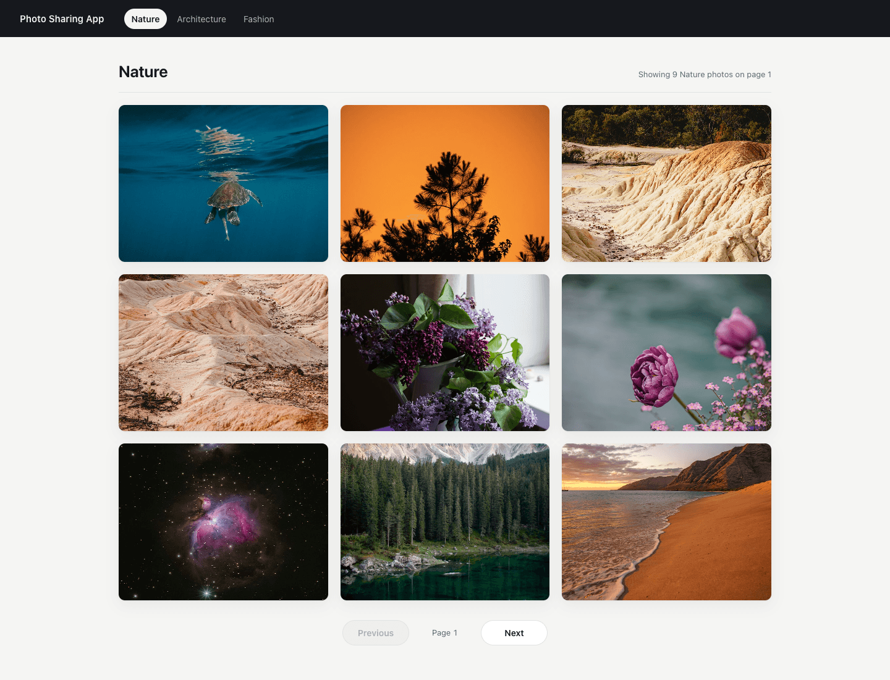
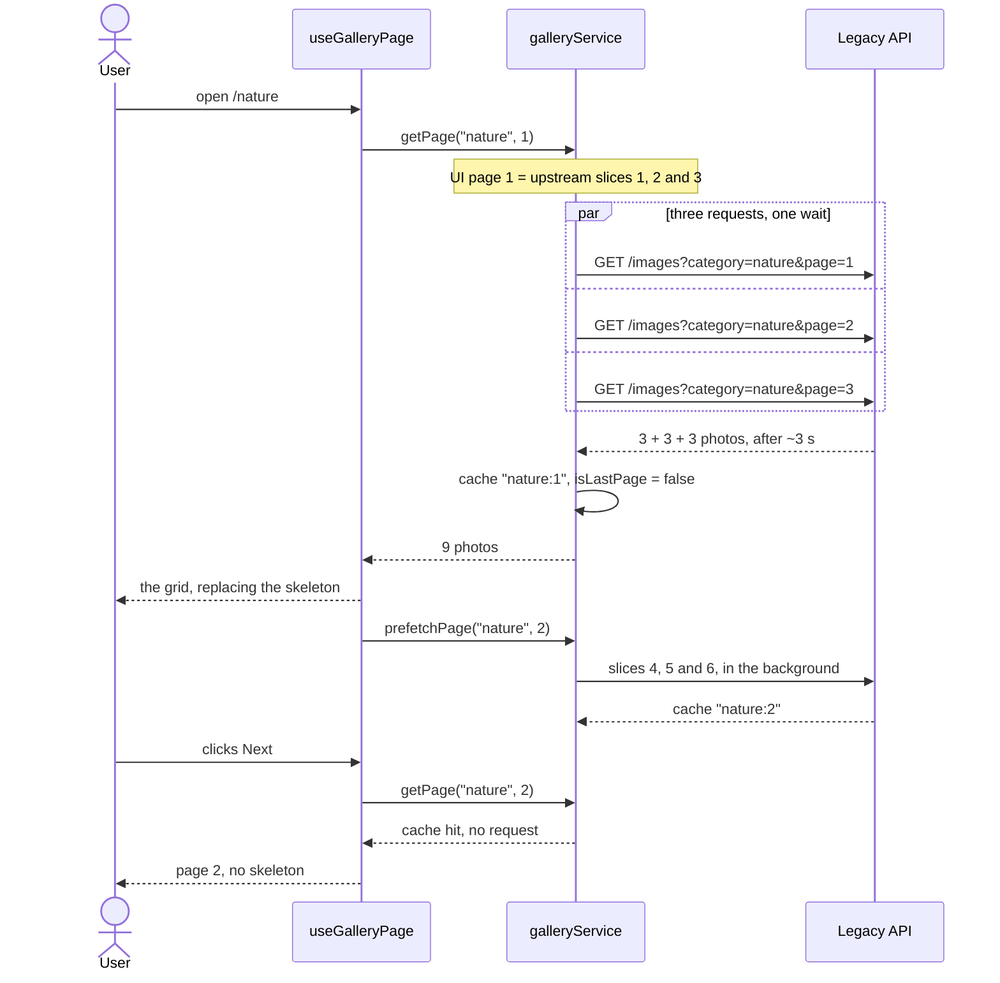
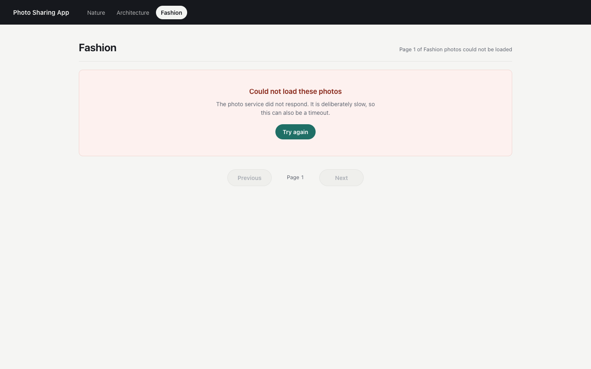
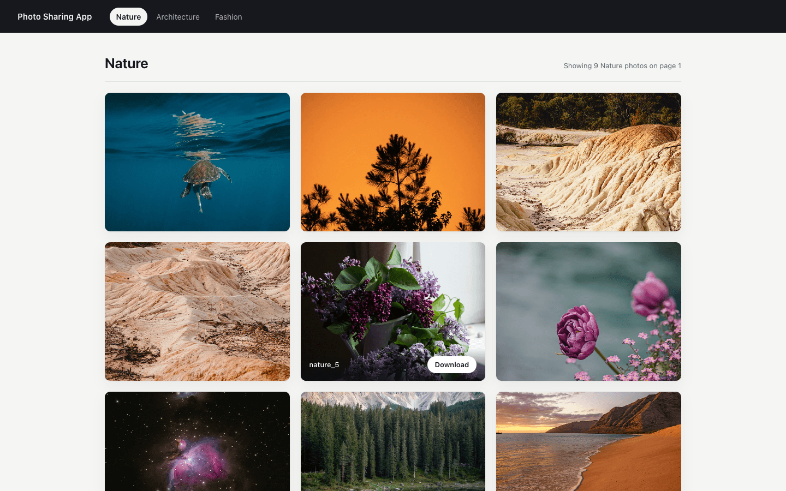
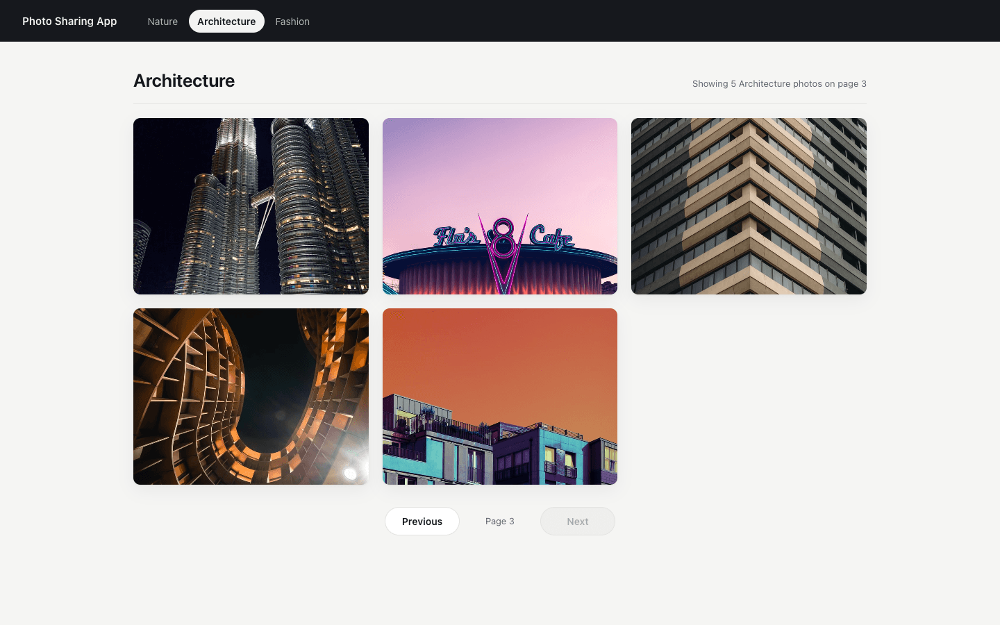

# Photo Sharing App

A React single-page app that browses 66 photos in three categories — nine to a
page in a 3 x 3 grid, with next/previous navigation and a download button on
every photo. It is a Valhalla technical test, and the brief is a _refactoring_
brief: improve the app without changing what it does for the user.

What makes it interesting is the API it has to live with. `src/do-not-refactor/`
is an Express service the brief forbids touching, and it returns **at most 3
photos per request** after sleeping **3 seconds**. The UI shows 9. Everything
below is about that gap.



## Three per call, nine per page

The constraint is right there in the off-limits code: `const LIMIT = 3` in
`image-db.js`, and a `setTimeout(..., 3000)` wrapped around every response in
`server.js`. Done naively — three requests one after another — a page costs 9
seconds, and paging back to one you have already seen costs 9 more. Everything
that fixes it lives in `data/galleryService.js`:

1. **Batch in parallel.** A page is three slices fetched with `Promise.all`, so
   three 3-second requests overlap into one ~3-second wait.
2. **Cache assembled pages**, so `Previous` is free, and **de-duplicate pages in
   flight**, so a prefetch the user then navigates to does not hit the API twice.
3. **Prefetch the next page.** The seconds spent looking at a page are free
   time, and spending them ahead makes `Next` effectively instant.

A fourth piece makes the rest safe: every in-flight page owns an
`AbortController`, so leaving a category aborts its requests rather than
ignoring their results — while requests for the _current_ category are left to
finish into the cache.

## One page load, start to finish



The service never learns what a "page" is from the API: it divides `pageSize` by
whatever `sliceSize` the source reports, so one serving nine at a time would
fire a single request.

## What that is worth

Wall-clock, click to a full grid of nine decoded photos, median of three runs
through a real browser. The script is committed as `docs/measure.js`.

| Action                                    |  Before |     After |
| ----------------------------------------- | ------: | --------: |
| Cold load of page 1                       | 3268 ms |   3147 ms |
| `Next` clicked the instant page 1 appears | 3056 ms |   3003 ms |
| `Next` after 3.5 s of looking at the page | 3043 ms | **39 ms** |
| `Previous`, back to page 1                | 3045 ms | **33 ms** |
| `Next` again, to a page already visited   | 3050 ms | **33 ms** |
| Switching category, cold                  | 3049 ms |   3050 ms |

**The first view of any page still costs one 3-second round trip, and nothing on
the client can change that.** Rows 1 and 6 are the proof, and row 2 is the
deliberate non-improvement: click `Next` the moment the grid appears and the
prefetch has only just started, so you wait anyway — de-duplicated with the
click, so never _slower_. What moved is every later visit to a page. The
"before" column was measured during the refactor against the pre-refactor code,
which is not in this repository's history — a recorded measurement, not one you
can re-derive here.

### Bytes shipped

|                                         |       Bytes |    Gzipped |
| --------------------------------------- | ----------: | ---------: |
| Before, as committed                    |     171 706 |     54 668 |
| Before, patched so it actually rendered |     178 218 |     56 743 |
| After                                   | **159 738** | **51 741** |

The "after" row you _can_ re-derive: `npm run build`, then
`cat dist/*.js | wc -c` and `cat dist/*.js | gzip | wc -c`. Against the
functional baseline that is **−18 480 B raw (−10.4 %)**, **−5 002 B gzipped
(−8.8 %)**, from three removals: **axios** → `fetch`, which also brings the
native `AbortSignal` the cancellation needs; **react-loader-spinner** → a CSS
skeleton grid, the better loading state anyway; and **Bootstrap 4 from a CDN** →
355 lines of local CSS. Content hashes and a vendor chunk cost a measured
~1.2 KB of scope hoisting, and source maps ~10 KB of shipped JS, so they are off
in production.

## While the user waits

`screens/CategoryScreen.js` holds no data logic of its own. It renders one of
four states — skeleton tiles, the grid, an explicit empty panel, or an error
panel with a working retry — and a `role="status"` region announces which one is
on screen ("Showing 9 Nature photos on page 1"). Photos carry intrinsic
dimensions and `loading="lazy"` so tiles do not reflow as they arrive, the
shimmer has a `prefers-reduced-motion` branch, and the grid falls back to two
columns and then one.



## Running it

```
npm install
npm start                     # API on :8888, dev server on :3000, via concurrently
docker compose up --build     # or nginx + a built bundle on :8390, API on :8391
```

| Variable       | Default                 | Notes                                                                                     |
| -------------- | ----------------------- | ----------------------------------------------------------------------------------------- |
| `API_PORT`     | `8888`                  | Port the legacy API listens on — and the port it bakes into every photo URL it returns.   |
| `API_BASE_URL` | `http://localhost:8888` | Base URL the SPA calls. Inlined by `DefinePlugin` at **build** time, not read at runtime. |
| `PORT`         | `3000`                  | `webpack serve` port, development only.                                                   |
| `HOST`         | `localhost`             | `webpack serve` host, development only.                                                   |

Because the image store builds absolute photo URLs out of its own port number,
that port must be identical on both sides of any mapping — hence `8391:8391` for
the API in compose, while the web container is mapped `8390:8080`.

**Docker status, stated plainly: the images have never been built.** The
refactor log records `Build verified: NOT RUN — deferred, RAM constraint` and
`Boot verified: NOT RUN — deferred, RAM constraint`, and the only Docker command
run was `docker compose config -q`, which parses cleanly. What _was_ verified is
the production artefact outside Docker: built with
`API_BASE_URL=http://localhost:8391 npx webpack --mode production`, served by
`python3 -m http.server` and loaded in Chromium — nine photos, no page errors.

## Where the code lives

Dependencies point one way: `components` → `useGalleryPage` → `galleryService` →
`ImageSource` ← `legacyImageSource` → `httpClient` → the API. That is a
repository with a swappable data source: `galleryService` is the repository,
`imageSource.js` the port, `legacyImageSource` the adapter, and `app.js` the
composition root.

```
src/refactor-this/
  app.js                     picks the ImageSource - the only file that decides
  data/imageSource.js        the contract: sliceSize + fetchSlice(category, slice, {signal})
  data/legacyImageSource.js  adapter over the 3-per-call API
  data/galleryService.js     batch, cache, de-dupe, abort, prefetch - no React import
  data/httpClient.js         fetch + AbortSignal, 46 lines
  hooks/useGalleryPage.js    the only place React meets the data layer
  screens/CategoryScreen.js  four states, no data logic
  __tests__/                 74 tests, including an in-memory ImageSource
src/do-not-refactor/         the crippled Express API - off limits per the brief
docker/nginx.conf            SPA fallback, gzip, immutable caching for hashed chunks
```

`src/do-not-refactor/` is exempted from Prettier and from the style rules in
`.eslintrc.json` — its style is not mine to change — but it is still linted for
errors, and `__tests__/imageDb.test.js` pins the 3-item pagination contract the
frontend has to live with.

## The one seam

`data/imageSource.js` is the whole extension point: an object with a `sliceSize`
and a `fetchSlice(category, slice, { signal })`. Replacing the legacy API means
one new adapter and one changed line of `app.js`. Two things show that is not
speculative: a source declaring `sliceSize: 9` makes the gallery fire one
request per page instead of three, and a test asserts that; and every UI test
drives the real components through a second implementation
(`__tests__/helpers/imageSources.js`) rather than `jest.mock`-ing a module.

## Three things a green test suite could not see

**The bundle did not run in a browser.** The refactor log records the committed
bundle throwing `regeneratorRuntime is not defined` on every `ImageCard` and
rendering nothing: `@babel/preset-env` had no `targets`, so it transpiled
`async`/`await` to regenerator, while `regenerator-runtime` was loaded in
`jest.setup.js` — so the suite passed over a blank app. The mechanism is still
checkable: transform `components/ImageCard.js` with `@babel/preset-env` and no
`targets` and the output carries two `regeneratorRuntime` references, where the
`targets` now in `.babelrc` leave none. The polyfill is gone from the test
setup, so the suite can no longer paper over it.

**Download did not download.** Photos are served from a different origin than
the app, and browsers ignore the `download` attribute on a cross-origin link, so
the button merely navigated to the jpeg. `ImageCard` now fetches the bytes and
hands the browser an object URL from our own origin, falling back to a new tab.



**The last page could be invisible.** A short page proves a category is
exhausted, but one that divides exactly by 9 ends on a _full_ page, so the
short-page check says nothing and `Next` leads to a blank grid. The prefetch
already knows the answer, so the hook takes it for free and disables `Next` when
the following page comes back empty. `architecture` holds 23 photos, so it shows
the other half — a partially filled tail:



## Tests

```
npm test                 # 74 tests, 10 suites
npm run test:coverage    # 98.5 % statements, 89.56 % branches, 100 % functions
```

Keeping `galleryService` framework-free means the hard logic is tested directly
rather than through the DOM — 16 tests covering parallelism (asserted by
checking all three requests are outstanding before any answers), caching,
de-duplication, prefetching, aborts, partial tails and a `sliceSize: 9` source.

## Calls worth arguing with

**One file under `src/do-not-refactor/` was modified: `config.js`**, from
`port: 8888` to `port: Number(process.env.API_PORT) || 8888`. Default behaviour
is unchanged. It is the only file in that directory without a `// DO NOT MODIFY`
banner — `server.js` and `image-db.js` both carry one and are untouched — and
because the image store bakes its own port into every photo URL, without an
override the stack can only ever run on 8888. Reverting costs only the ability
to relocate the port.

**No new features, deliberately**, and **React 16 and `ReactDOM.render` are
kept**. The brief is to refactor without changing the four required behaviours;
upgrading React would also change the double-invoke semantics of the effects in
`useGalleryPage`, which deserves its own piece of work.

## Known gaps

- The first view of a page still takes ~3 seconds, and always will.
- The cache is in memory, unbounded and never invalidated — correct for 66
  static photos, wrong for a real catalogue.
- Categories are hard-coded in `constants/general.js` (the API has no endpoint
  that lists them), and `API_BASE_URL` is baked in at build time, so one image
  cannot be re-pointed at a different API without rebuilding.
- No end-to-end suite runs in CI: `docs/measure.js` and `docs/screenshots.js`
  need Playwright installed separately and are run by hand.
- `npm audit` flags vulnerabilities in the transitive dev tree (webpack 5.68
  era); fixing them means major bumps the brief argues against.
